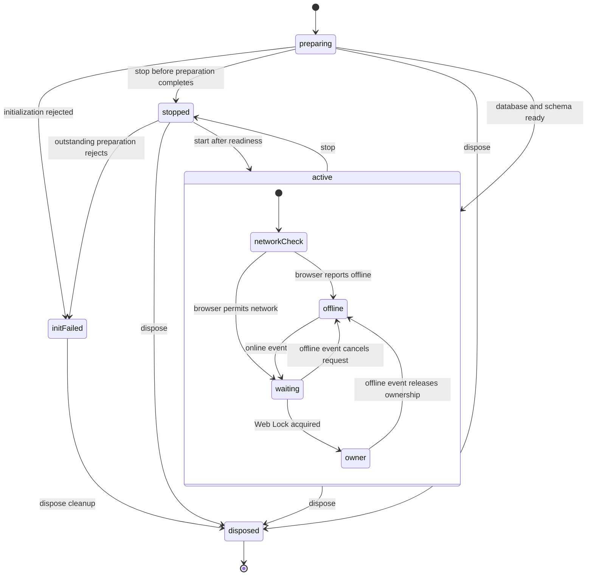
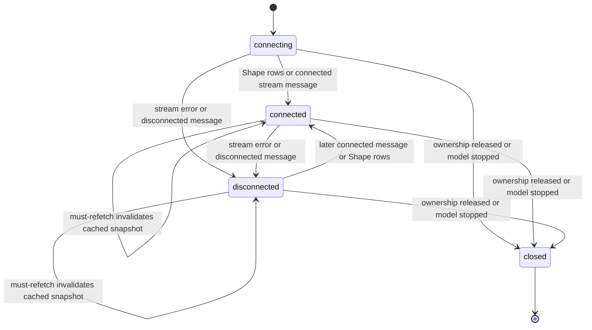
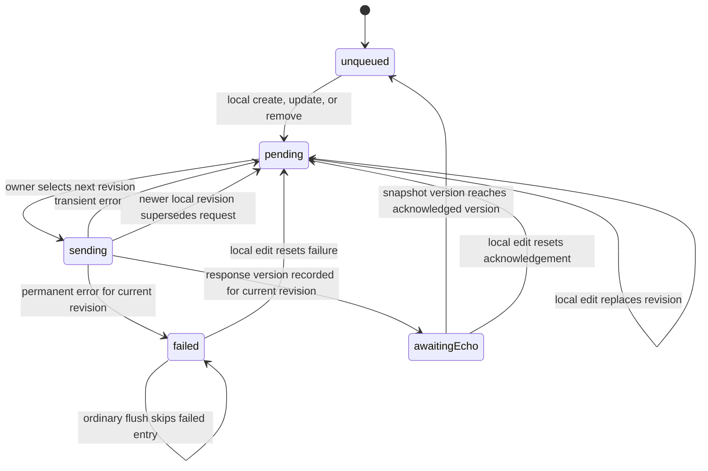
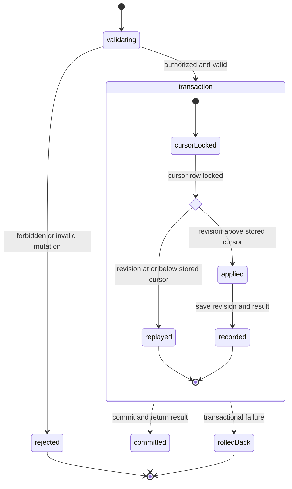
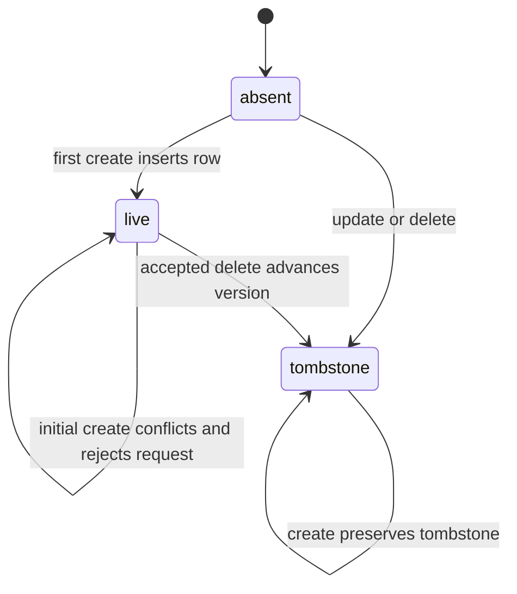

# Electric sync state machines

These diagrams model `electric-managed-sync.mjs`, `electric-offline-model.mjs`,
and `electric-server-plugin.mjs`. They describe the plugin's own control flow,
not Electric's internal replication protocol. State names are analytical labels
unless explicitly identified as persisted fields. Timestamps, revisions, rows,
and versions are data guards, so the precise model is an extended FSM.

The main diagrams assume `sync: true` on both client and server. Without managed
sync or a supplied `localDb`, the client streams Shapes directly and sends CRUD
calls directly; it has no persistent local mutation queue or owner election.

## One managed model in one tab



- `preparing` creates or obtains the PGlite database, prepares local tables, and
  installs the BroadcastChannel. Preparation is serialized across this plugin
  instance's models. Reads and writes wait for readiness; failure rejects them.
- `waiting` is a follower with a pending Web Lock request. It can read and write
  shared local rows and enqueue mutations; only the owner streams and flushes.
- The lock key is database/model-specific. One tab can own one model and follow
  another. PGlite's database leader is a separate role and need not be the sync
  owner. Closing an owner lets another waiting tab acquire the lock.
- `offline` means the browser reports offline, so ownership is released. This
  differs from a stream error while the browser still reports online: a stream
  error does not by itself release ownership.
- Release invalidates old stream callbacks, cancels the pending lock request,
  and stops owner work. The lock callback drains background work before exiting.
  Snapshot reset is ordered after previously queued snapshot tasks.
- `stop()` retains local rows and the mutation queue. Reads and local mutations
  remain available. `start()` requests ownership; its promise does not wait for
  ownership, a snapshot, or complete synchronization.
- `dispose()` removes network listeners, stops the model, waits for outstanding
  work, closes its channel, and removes it from the model cache. The old API
  cannot restart; a new `createElectricModel` call can create a fresh instance
  while the plugin itself remains open. Disposing the plugin closes its owned
  database after disposing all models; a supplied `localDb` is caller-owned.
- `initFailed` has no built-in initialization retry for that model instance.
  Disposal still performs cleanup, although its promise can reject when
  readiness failed. A non-abort Web Lock request failure is reported and does
  not automatically enqueue a replacement request.

## The owner's stream connection



Actual reconnection/retry mechanics belong to `ShapeStream`. This wrapper marks
its connection false on a stream error and reports the error; it does not create
a fresh stream solely because an error occurred. Generation guards ignore late
callbacks from stopped streams. A `must-refetch` message resets the cached
snapshot; the connection flag is still independently taken from the stream.

Queue uploads are gated by ownership and browser network state, **not** by the
stream's `connected` flag. Writes can reach the server while the Shape stream
is disconnected. Followers receive the owner's connection status through
BroadcastChannel, so `online` is an observation, not a convergence guarantee.

## One local mutation queue entry

There is at most one entry per `(model_name, row_id)`. Local CRUD and queue
updates commit together in a PGlite transaction. A later local edit replaces
the entry's payload and allocates a new monotonically increasing revision.



| Diagram state | Persisted queue representation |
| --- | --- |
| Unqueued | No queue entry |
| Pending | `status = 'pending'`, `acknowledged_version IS NULL` |
| Sending | Same persisted state as Pending; selected request is in flight |
| Awaiting echo | `status = 'pending'`, `acknowledged_version` is set |
| Failed | `status = 'failed'`, with `failure_reason` |

The critical acknowledgement condition is:

```text
incoming row ID = queued row ID
AND incoming.version >= queued.acknowledged_version
```

The snapshot transaction removes acknowledged queue entries first, then adopts
unprotected live rows and removes unprotected rows missing from the live
snapshot. Tombstones carry versions too, allowing deletes to be acknowledged.
A mutation response alone does not clear the queue; if a sufficient snapshot
was already cached, reconciliation can clear it immediately after the response.

Additional transition guards and actions:

- Only the owner flushes, with one flush loop at a time per local model instance.
  It selects unacknowledged Pending entries in revision order. A timer, local
  write, owner startup, online event, owner BroadcastChannel notification, or
  explicit `flushQueue()` can trigger a flush.
- A transient failure leaves the entry Pending and ends the current flush loop.
  A later trigger retries it. A permanent failure marks the matching revision
  Failed and permits the loop to continue with other entries.
- Missing-parent failures defer that row while later entries are attempted.
  Successful writes make deferred rows eligible again in the same flush, so
  reverse-ordered parent/child creations can finish. A pass without progress
  ends the flush and leaves unresolved rows Pending.
- Permanent means `forbidden`, a `TypeError`, or HTTP 4xx except 408, 425, and
  429, plus `sync-create-conflict` and PostgreSQL not-null, unique, check, and
  exclusion constraint violations. A response without a version is an error
  and remains retryable.
- Responses and failure writes are revision-guarded. An old response must not
  acknowledge a newer local edit. If a create was edited while its request was
  in flight, its successful response converts the queued create into an update
  with another revision. If the old request failed, the newer create stays
  queued and the server handles its newer revision idempotently.
- Any queue entry, including Failed and Awaiting echo, protects the optimistic
  local row from snapshot replacement. Failed entries are not automatically
  retried or rolled back. A subsequent local operation resets their status.
- Local remove hides the row immediately and queues delete. Update requires a
  local row. Updates to an unacknowledged queued create retain action `create`;
  updates after its acknowledgement use action `update`.

## One server mutation request



The cursor key is `(table_name, client_id, row_id)`. Equal or older revisions
return that cursor's stored result without applying another mutation. A newer
revision applies its operation and saves its result atomically with the row
change. Losing the response after commit is therefore safe to retry. An older
revision returns the latest stored cursor result, not necessarily its own
original result.

The cursor serializes requests for the same client/row. It does not impose a
revision ordering across different clients; PostgreSQL row conflicts and
transaction execution determine their resulting writes. Server versions come
from `electric_sync_version_seq`, not client timestamps.

## One server record in sync mode



These transitions describe newer cursor revisions, including rejected creates
that leave the record unchanged. Replayed revisions do not change the record.
A later create from a cursor that already has an accepted revision is
treated as an update when it contains non-key data. Updates affect only live
rows; updating an absent or deleted row writes a tombstone instead. This sync
API has no tombstone-to-live transition or automatic tombstone pruning.

A create colliding with a live row throws `sync-create-conflict` and rolls back
its cursor. A newer create from that client therefore cannot be mistaken for
an edit of a successfully inserted row. Creates colliding with tombstones
continue to return the tombstone.

| State | PostgreSQL representation | Local snapshot result without a queued mutation |
| --- | --- | --- |
| Absent | No row | No local row |
| Live | Row with `deleted = false` and `version` | Local row mirrors snapshot |
| Tombstone | Row with `deleted = true` and `version` | Local row removed |

`tombstoneData` supplies values needed to insert a missing-row tombstone and
can clear selected fields on an existing row. It does not necessarily erase
every other stored column.

## What status means

`getStatus()` is a combination of independent observations, not a single FSM
state:

- `pending` counts both unsent mutations and acknowledged mutations awaiting
  their Electric echo.
- `failed` counts permanently failed queue entries.
- `online` combines the browser network flag and observed stream connection.
- Managed `error` is the latest reported error message. It is not explicitly
  cleared on recovery, so its presence alone does not establish current failure.

`pending = 0` does not establish initial snapshot readiness, and the plugin
exposes no explicit fully-caught-up state. The main completion boundary for a
local mutation is its queue entry being removed after version reconciliation.
