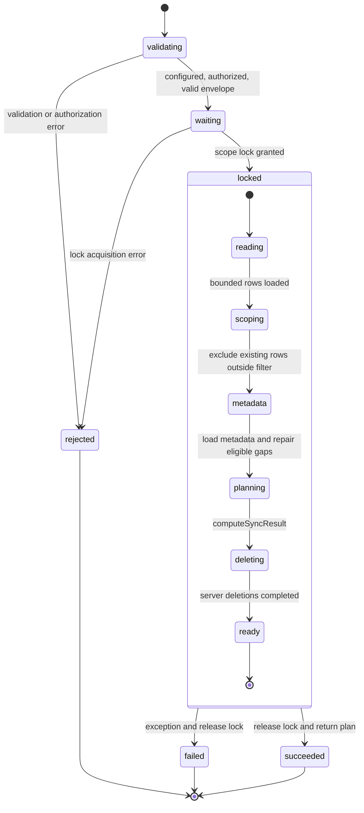
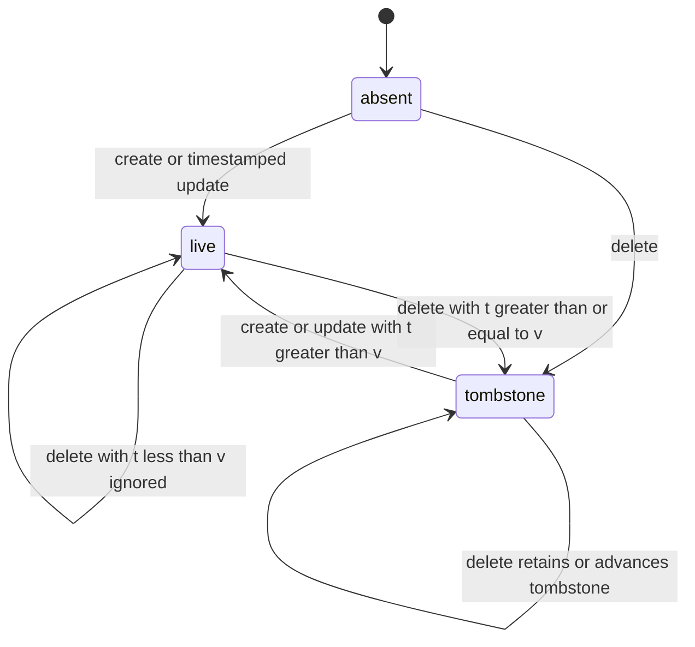

# Drizzle sync state machines

This models the restored implementation in `src/sync-server-plugin.mjs` and
`src/sync-algorithm.mjs`. The state names are analytical labels, not persisted
plugin fields. Because timestamps, UIDs, filters, and rows are unbounded data,
the precise model is an extended FSM: finite control states plus data guards.

## One server sync request

Each `sync.go(modelName, where, clientMetadataDict)` invocation has its own
machine. There is no single global synchronization state.

- `validating` checks model configuration, authorization, metadata envelope,
  and client record limit. Detailed metadata timestamp validation happens in
  `planning` with the default algorithm; filter validation happens during reads.
- The lock queues overlapping filters for the same model. Independent scopes
  can proceed concurrently. This lock is local to the plugin instance.
- `metadata` considers server row UIDs and effective client UIDs, so deleted
  server records can still be found through their metadata tombstones.
- `deleting` calls authorized `deleteWithMeta` operations. Each mutation has its
  own transaction and metadata row lock. The entire sync request is **not one
  transaction**: failure can leave earlier repairs or deletions committed.
- Success returns a reconciliation plan. It does **not** mean the client has
  applied the plan or uploaded its mutations. Retry is a new request initiated
  by the client, not an automatic transition inside the server request.

## One server record

For a fixed `(modelName, uid)`, the normal persistent states are:

| State | Model row | Metadata |
| --- | --- | --- |
| Absent | Missing | Missing |
| Live | Present | No deletion timestamp |
| Tombstone | Missing | Deletion timestamp retained |

`t` is the incoming operation timestamp. `v` is the stored version selected
by the handler: `deleted_at`, otherwise `updated_at`, otherwise `created_at`.
The transitions below assume valid timestamps, authorization, successful
transactions, and normal metadata integrity.

A deletion wins a tie with a live version. Equal live timestamps produce no
reconciliation action; the algorithm does not compare row contents. Newer
creates or updates can resurrect a tombstone. No automatic tombstone pruning
or transition back to Absent exists.

Integrity gaps add exceptional states: a row without metadata, metadata without
a row, or a row coexisting with a tombstone. The implementation repairs selected
gaps during sync and mutation handling. These repairs depend on the incoming
metadata and timestamps; they are not unconditional background transitions.
`updateWithMeta` also permits a missing timestamp, which can create
timestamp-free metadata when no stored version blocks it; the normal-state
diagram intentionally assumes timestamped operations.

## Reconciliation outputs

The pure algorithm is a guarded decision function over a snapshot. Its six
outputs are actions, not persistent record states.

| Output | Meaning | Executor |
| --- | --- | --- |
| `addClient` | Copy server row and metadata into local cache | Client |
| `updateClient` | Replace local copy with server version | Client |
| `deleteClient` | Remove local copy using the deletion version | Client |
| `addDatabase` | Upload a locally held row | Client calls `createWithMeta` |
| `updateDatabase` | Upload the newer local version | Client calls `updateWithMeta` |
| `deleteDatabase` | Delete a server row and retain metadata | Server during `sync.go` |

For live versions on both sides, the newer timestamp wins. A deletion wins
against an equal or older live version. When the server row is absent, retained
server metadata still participates: a sufficiently new server version can
remove the client copy, while a newer live client version can recreate the row.
Server records outside `where` are excluded before these comparisons.
Server reads bracket row values with matching metadata versions and retry up
to three times when concurrent writes change the snapshot. Metadata repair
inserts missing versions without overwriting a concurrent mutation's metadata.

The client applies downloads before uploads. Failed sync uploads preserve local
dirty mutations for a later reconnect or explicit `synchronizeAll()`. Individual
upload failures can be caught while the rest of the synchronization continues,
so a resolved synchronization call does not prove every dirty row was accepted.
Timestamp guards on acknowledgements prevent an older response from clearing
a newer local mutation.
